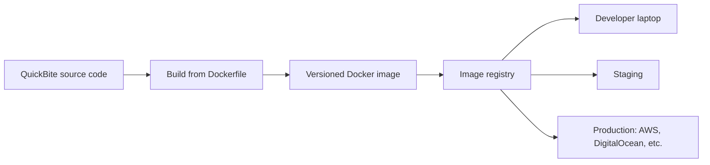
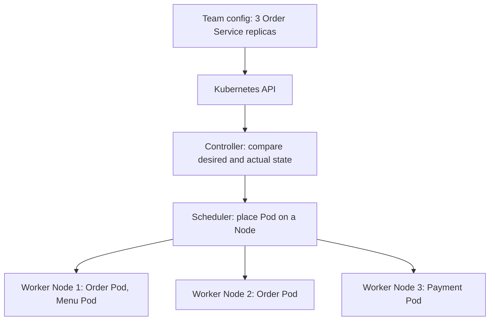
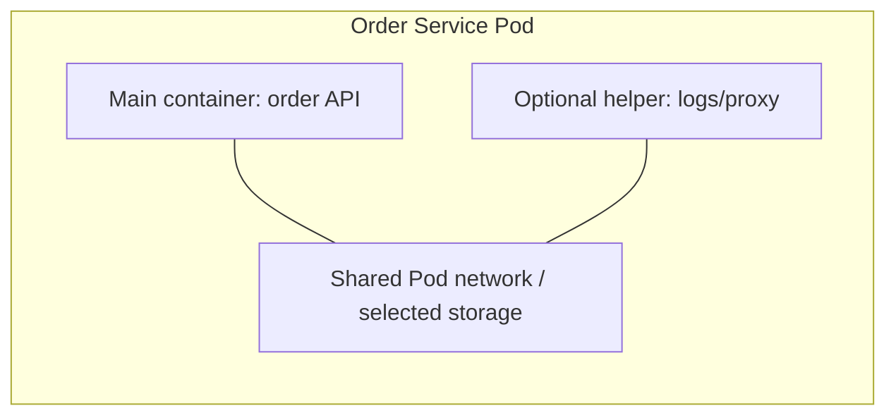
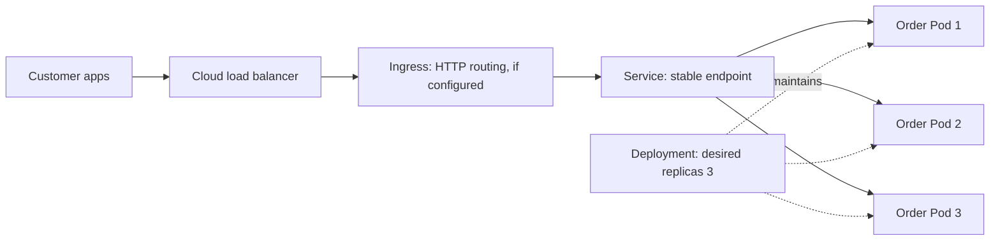
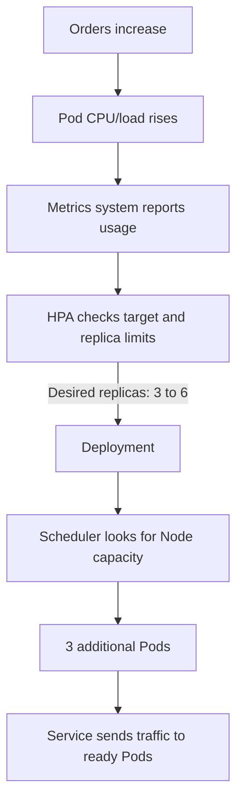

# Docker and Kubernetes — Explained with a Food Delivery App

**Language:** [HINGLISH](README.md) · [ENGLISH](README.en.md)

> **Docker packages an app consistently; Kubernetes manages running copies of that app across machines.**

This guide uses an imaginary food delivery company called **QuickBite**.

## 1. The “It works on my machine” problem

A developer builds QuickBite’s Order Service with Node.js 22. The production server has Node.js 18, or different dependency versions and settings. The app works on the laptop but fails on the server.

```text
Developer laptop                 Production server
Node.js 22                       Node.js 18
Dependency versions A            Dependency versions B
App works                        App fails
```

Docker helps keep the app’s runtime and dependencies in a repeatable package. This makes the local testing and deployment environments more alike.

## 2. Docker: Dockerfile, Image, Container

A **Dockerfile** is a recipe for building the app. Here is a simplified example:

```dockerfile
FROM node:22-alpine
WORKDIR /app
COPY package*.json ./
RUN npm ci
COPY . .
CMD ["node", "server.js"]
```

Docker builds an **image** from the Dockerfile. Think of an image as a packaged blueprint for running the app. Example tag: `quickbite/order-service:2.4.1`. The image can be stored in a registry. When an image starts, its running instance is called a **container**.

```text
Dockerfile --build--> Image: order-service:2.4.1
                           | run
                           +--> local container
                           +--> staging container
                           +--> production container
```

### From image to deployment



**Step by step:** (1) The developer changes the code. (2) Docker builds an image from the Dockerfile. (3) The image gets a version tag. (4) The registry stores it. (5) Compatible environments can run that same image. This reduces the need to install runtimes and dependencies manually on every server.

**Accuracy note:** A Docker image usually does not bundle a completely separate operating-system kernel. A container shares the host’s kernel; the image packages the app, runtime, and dependencies. The same image improves consistency, but configuration, secrets, networking, data, and hardware compatibility still matter. Passwords and API keys should not be baked into an image.

## 3. Why Kubernetes when there are many containers?

QuickBite has multiple copies of its Order, Payment, Menu, and Tracking services running across different machines. Managing copies, failures, capacity, and traffic by hand becomes difficult.

**Kubernetes** deploys and manages containerized apps in a cluster. The team describes the desired state—for example, “3 replicas of the Order Service”—and Kubernetes works to maintain it.

### Cluster overview

The **control plane** coordinates decisions. **Worker Nodes** are the machines where the app’s Pods run.



**Step by step:** The team provides the configuration; the control plane records it; a controller compares the actual Pods with the desired count; the scheduler places Pods on available Nodes; and the worker machine’s container runtime runs containers from images. With managed Kubernetes, the cloud provider may handle some control-plane work.

## 4. What is a Pod, and why have one?

A **Pod is Kubernetes’ smallest deployable unit.** A Pod usually contains one main app container. Sometimes it also contains a closely related helper container. Containers in one Pod can share networking and selected storage context, so Kubernetes schedules and manages them together.



A Pod is a replaceable running unit, not a permanent machine. It can fail or be replaced, and the new Pod may have a different address.

## 5. Deployment, Service, and the request path

- **Pod:** one running copy of the app.
- **Deployment:** describes how many matching Pods are wanted and how to update them.
- **Service:** provides a stable endpoint for sending requests to matching Pods.
- **Node:** a worker machine where Pods run.



**Request path:** A customer request reaches the load balancer; a configured Ingress can route it; the Service sends it to available Order Pods. The Deployment works to maintain the desired number of Pods. A load balancer and Ingress are not automatically configured in every cluster.

## 6. What happens if a Pod or container crashes?

```text
Before:      Pod 1 | Pod 2 | Pod 3       (3 running)
Crash:       Pod 1 | Pod 2 | failed      (2 healthy)
Controller:  desired 3, actual 2          (tries to replace it)
After:       Pod 1 | Pod 2 | Pod 4       (3 running)
```

A Deployment/controller can create a replacement Pod. If a process inside a container exits, kubelet can restart the container according to its configured restart policy. Kubernetes does not fix a bug: if every new Pod crashes for the same reason, the service can remain unavailable. Recovery time depends on startup and available capacity.

## 7. How does autoscaling work during high traffic?

During the lunch rush, load on the Order Service increases. The team can configure a **Horizontal Pod Autoscaler (HPA)**. HPA compares metrics such as CPU usage against a configured target.



**Step by step:**

1. The lunch rush increases requests and Pod load.
2. The metrics system reports CPU or another configured metric.
3. HPA compares usage with its target and raises the desired replica count—for example, from 3 to 6.
4. The Deployment asks for 3 more Pods.
5. The scheduler places them on available Nodes.
6. Once ready, the Service can send requests to the new Pods too.
7. When demand drops, replicas can be reduced according to configured rules and limits.

Autoscaling requires configured metrics, targets, minimum/maximum replicas, and startup behavior; it is not instantaneous.

### What if there is no room on the Nodes?

**Pod autoscaling** adds app copies; **Node autoscaling** adds machines. They are separate features.

```text
HPA: “We need 6 Pods”
          |
Scheduler looks for room on existing Nodes
      /                         \\
Room available              No room
Pods are scheduled          Pods may stay Pending
                                |
                         Is Node autoscaling configured?
                                |
                         Request a new Node from the cloud
```

If Node autoscaling is configured, it can request another machine. Quotas, cloud capacity, startup delays, and cost still matter.

## 8. The complete food-app scenario

```text
Normal time: 3 Order Pods
Lunch rush:  HPA sees load -> desired count changes from 3 to 6
             Deployment creates Pods
             Scheduler looks for room on Nodes
             Service sends requests to ready Pods
Rush ends:   HPA may reduce the count according to configured rules
```

If the database is slow or the payment provider is down, adding Order Pods will not automatically fix that bottleneck. The whole request path needs monitoring.

## 9. Real company examples

Company architectures can change over time. These are specific examples from published material, not universal claims about every service.

### Netflix

Netflix Engineering has described using Docker containers and its own **Titus** container-management platform. Titus integrates container execution and resource management with Netflix’s cloud infrastructure. So it would be inaccurate to say “Netflix runs everything on Kubernetes”—its published example includes its own platform.

- [Netflix: The Evolution of Container Usage](https://netflixtechblog.com/the-evolution-of-container-usage-at-netflix-3abfc096781b)
- [Titus project](https://netflix.github.io/titus/)

**QuickBite lesson:** Docker images provide repeatable workloads; an orchestrator manages workloads across many machines. Not every company has to use Kubernetes.

### Spotify

Spotify Engineering has written about its extensive use of GKE and improving the Kubernetes experience for developers. In a large organization, shared platform/tools help teams deploy and troubleshoot.

- [Spotify: Designing a Better Kubernetes Experience for Developers](https://engineering.atspotify.com/2021/3/designing-a-better-kubernetes-experience-for-developers)

### Philips Hue / Signify

According to a Google Cloud case study, the Philips Hue platform uses GKE and handles changing usage patterns across regions—for example, morning activity in Europe and evening activity in the Americas.

- [Signify / Philips Hue case study](https://cloud.google.com/customers/signify-data)

**QuickBite lesson:** Lunch and dinner rushes happen at different times in different cities; regional demand matters when planning capacity.

## 10. Docker vs Kubernetes

| | Docker | Kubernetes |
|---|---|---|
| Main job | Build images and run containers | Manage containerized apps in a cluster |
| Unit | Image, container | Pod; often managed through a Deployment |
| Question | “How do I package the app with the same dependencies?” | “How many Pods, on which Nodes, and what happens during failure or traffic spikes?” |

## 11. Analogy and recap

- **Dockerfile** = recipe.
- **Image** = packaged app blueprint.
- **Container** = app running from that blueprint.
- **Pod** = Kubernetes’ deployable/managed running unit.
- **Deployment** = controller for how many copies are wanted.
- **Service** = stable route that sends requests to available copies.
- **Kubernetes** = system coordinating Pods and machines.

> **Recap:** Docker packages the app into a consistent image. Kubernetes runs that image in Pods and manages configured recovery, networking, and scaling.

## 12. Quick self-check

1. **Image vs container?** Image is the blueprint; container is the running instance.
2. **Pod?** Kubernetes’ smallest deployable unit, usually with one main container.
3. **Pod fails?** A controller can request a replacement to maintain the desired replica count.
4. **High traffic?** With configured metrics, HPA changes Pod count; the Deployment creates replicas.
5. **No Node capacity?** Pods may stay Pending; a configured Node autoscaler can try to add a machine.
6. **Does Kubernetes fix bugs?** No—it manages the app but does not fix code or database bugs by itself.

## Further reading

- [Docker: Writing a Dockerfile](https://docs.docker.com/get-started/docker-concepts/building-images/writing-a-dockerfile)
- [Kubernetes concepts](https://kubernetes.io/docs/concepts/)
- [Kubernetes Pods](https://kubernetes.io/docs/concepts/workloads/pods/)
- [Horizontal Pod Autoscaling](https://kubernetes.io/docs/tasks/run-application/horizontal-pod-autoscale/)
- [Node autoscaling](https://kubernetes.io/docs/concepts/cluster-administration/node-autoscaling/)